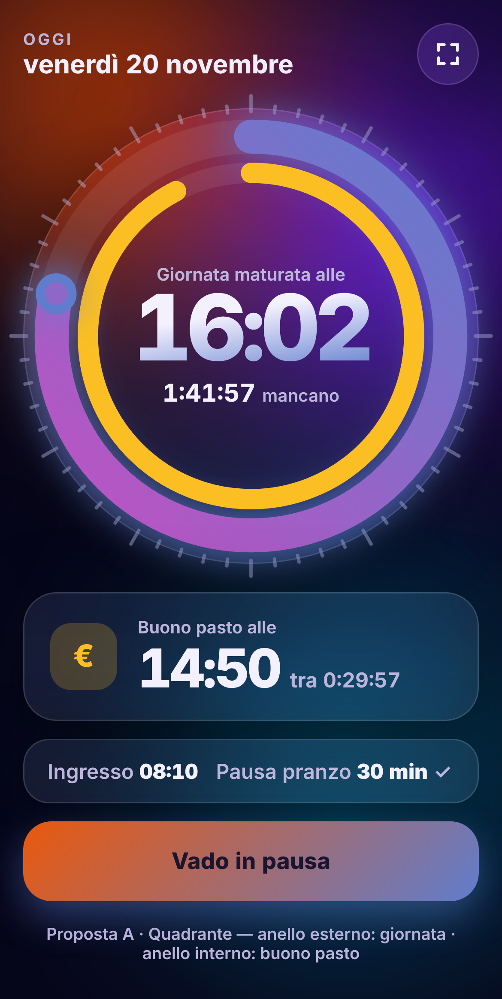
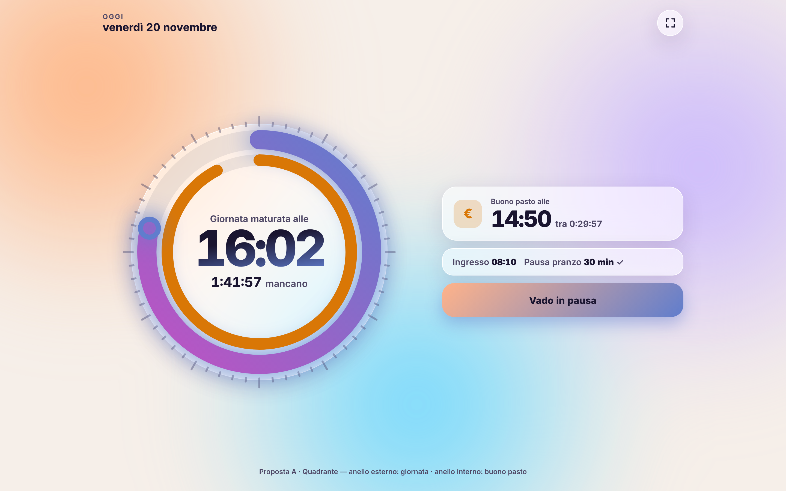
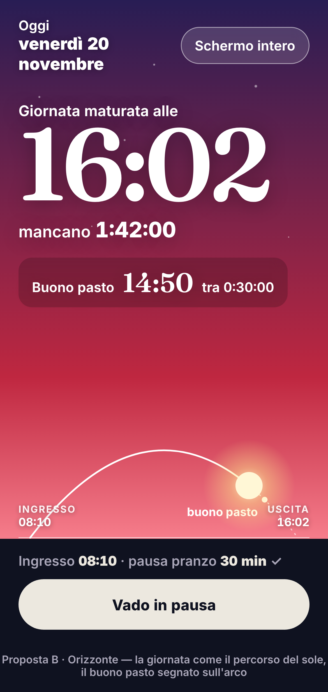
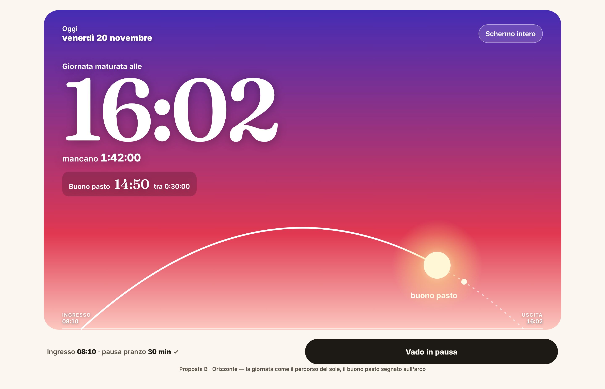
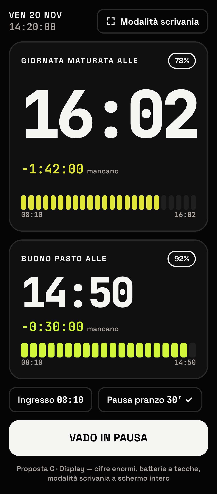
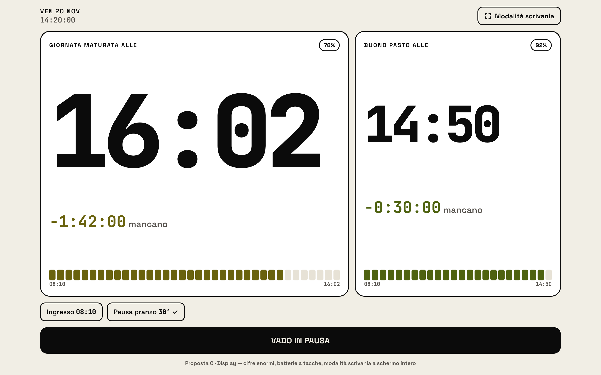

# Tre proposte grafiche (da scegliere)

Tutte mostrano solo i due orari, **giornata maturata** e **buono pasto**, calcolati con il vero motore dell'app (regole ePAS).
Pagine dimostrative: si aprono servendo il repository (es. `python3 -m http.server`) e andando su `docs/stili/…`.
Parametri: `?ora=14:20` ora simulata, `?velocita=120` tempo accelerato, `?fine=1` giornata già maturata.

Per tutte: conto alla rovescia vivo, colori che cambiano col procedere della giornata, coriandoli e vibrazione quando
matura il buono e la giornata (disattivati con «riduci movimento»), modalità a schermo intero con schermo sempre acceso.

| | Idea | Telefono (scuro) | Desktop (chiaro) |
|---|---|---|---|
| **A · Quadrante** ([pagina](a-quadrante.html)) | Quadrante in vetro su sfondo «aurora»: anello esterno = giornata, anello interno = buono pasto, orario enorme al centro |  |  |
| **B · Orizzonte** ([pagina](b-orizzonte.html)) | La giornata come il sole che attraversa il cielo; il cielo passa dal mattino al tramonto, il buono pasto è segnato sull'arco |  |  |
| **C · Display** ([pagina](c-display.html)) | Cifre giganti stile tabellone, batterie a tacche, la scheda diventa verde acceso quando matura; «modalità scrivania» |  |  |

Tutti gli screenshot (telefono e desktop, chiaro e scuro, più lo stato «maturata») sono in `screenshot/`.
Rigenerarli: `node tools/screenshot-stili.mjs`.
